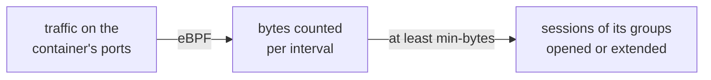



Let real traffic on a container's ports open or extend its sessions, the same way a proxy request does. Sablier counts the bytes with eBPF, so the protocol and the path don't matter.

Without it, Sablier only sees the HTTP requests that go through a reverse proxy plugin, so it misses two kinds of use:

- **Long-lived connections:** WebSockets and long streams send few or no new requests, so the session expires while the service is in use.
- **Traffic that bypasses the proxy:** Plex with `network_mode: host`, reached by LAN clients on `:32400`, never opens a session.



## Enable it

Turn on `--activity.enabled` and give Sablier the host cgroup namespace plus two capabilities, then label the containers to watch:

```yaml
# compose.yml
services:
  sablier:
    image: sablierapp/sablier:
    command:
      - start
      - --provider.name=docker
      - --activity.enabled=true
    cgroup: host
    cap_add:
      - BPF
      - NET_ADMIN
    volumes:
      - /var/run/docker.sock:/var/run/docker.sock

  plex:
    network_mode: host
    labels:
      - "sablier.enable=true"
      - "sablier.group=plex"
      - "sablier.activity.enable=true"
      - "sablier.activity.ports=32400"
      - "sablier.activity.session-duration=30m"

  homepage:
    labels:
      - "sablier.activity.ignore-source=true" # its Plex widget polls :32400
```

- **`cgroup: host` plus `cap_add: [BPF, NET_ADMIN]` is all it takes.** That's what was measured on a Raspberry Pi 4 with Docker 29.7.1 and kernel 6.8.0-1065-raspi, and Docker's default seccomp profile allowed the rest. Before Linux 5.11, also add `SYS_RESOURCE`.
- **Without the capabilities, Sablier refuses to start** and names what it needs:

  ```text
  Error: --activity.enabled: load eBPF maps (needs CAP_BPF and CAP_NET_ADMIN, and cgroup: host; before Linux 5.11 also CAP_SYS_RESOURCE): assign values: field Bytes: map bytes: map create: operation not permitted (MEMLOCK may be too low, consider rlimit.RemoveMemlock)
  ```

- **Without `cgroup: host`, Sablier starts but can't watch any container.** It can't reliably tell that it runs in its own cgroup namespace, so it doesn't refuse to start. It logs a warning at startup when it appears to, then a warning for each container it fails to watch, retried every 30s:

  ```text
  WRN Sablier appears to run in a private cgroup namespace; activity tracking needs cgroup: host
  WRN cannot watch instance for activity instance=stream error="cgroup /sys/fs/cgroup/docker/<id> not found: run Sablier with cgroup: host on the Docker host"
  ```

- **With `--activity.enabled=false`, the default,** Sablier loads nothing and needs no extra privileges.

The eBPF programs attach to each watched container's cgroup and only count: they never drop or change a packet. They live as long as Sablier's process, and when Sablier restarts, it attaches them again to the running watched containers.

## What counts

Every `--activity.interval`, Sablier reads how many bytes each watched container exchanged on its ports. A container whose count reaches its `sablier.activity.min-bytes` is active for that interval.

- **Only the watched ports count:** `sablier.activity.ports`, or the container's exposed ports.
- **Both directions count,** because a stream is almost all outgoing bytes.
- **Some sources never count:**
  - loopback, `127.0.0.0/8` and `::1`, because Docker health checks run inside the container and reach the service over loopback;
  - Sablier's own addresses, so its readiness checks don't keep anything running;
  - every container labeled `sablier.activity.ignore-source=true`, managed by Sablier or not, at its current IPs;
  - the address ranges in `--activity.ignore-cidrs`.
- **Traffic never starts a stopped container.** Proxy plugins still do the starting.

### Pollers on the host network

A container with `network_mode: host` has no IP of its own, so `sablier.activity.ignore-source` can't match it. Ignore it with the host's address instead:

```yaml
command:
  - start
  - --provider.name=docker
  - --activity.enabled=true
  - --activity.ignore-cidrs=192.168.0.2/32
```

On the Raspberry Pi above, Home Assistant runs with `network_mode: host`, and its Plex integration keeps a connection open to `:32400` from `192.168.0.2`. This also ignores any other client on that host.

## What gets extended

When a watched container is active, Sablier requests a session for **every member of each of its groups**, like a proxy request for the group.

- **Label the entry point, not its dependencies.** Traffic on Plex extends the whole `plex` group, its database included.
- **Without a `sablier.group` label, traffic extends only that container,** not every container in the implicit `default` group. An explicit `sablier.group=default` behaves like any other group.
- **The session lasts `sablier.activity.session-duration`.** It must be longer than `--activity.interval`, or Sablier doesn't watch the container and logs a warning.
- **Traffic never shortens a session.** A refresh lasts the longer of `session-duration` and the time the group's members have left, so a 5m refresh doesn't cut a 30m proxy session short.
- **While traffic flows, the session doesn't expire,** as long as the gaps between bursts stay shorter than `session-duration`. [Anti-affinity](/features/anti-affinity/) therefore sees no gap and doesn't restart the instances it paused.

These requests appear in `sablier_session_requests_total{strategy="activity"}`.

## The `activity.*` labels

Every activity setting is a label on a Docker container:

| Label | On | Format | Default |
|-------|----|--------|---------|
| `sablier.activity.enable` | watched container | Boolean | `false` |
| `sablier.activity.ports` | watched container | Comma-separated `port[/proto]`: `32400`, `1900/udp` | the container's exposed ports |
| `sablier.activity.session-duration` | watched container | Duration: `30m` | `--sessions.default-duration` |
| `sablier.activity.min-bytes` | watched container | Docker units: `1m` | `64k` |
| `sablier.activity.ignore-source` | any container | Boolean | `false` |

- **`sablier.activity.enable=true` needs `sablier.enable=true`.** Sablier only watches the containers it manages, while they run.
- **A bare port number means TCP.**
- **`min-bytes` applies to one interval,** both directions together.
- **An invalid value is logged and ignored**, like any other label.

The server flags:

| Flag | Default | Meaning |
|------|---------|---------|
| `--activity.enabled` | `false` | Load the eBPF programs and watch the labeled containers. |
| `--activity.interval` | `20s` | How often the counters are read. |
| `--activity.ignore-cidrs` | none | Source address ranges whose traffic never counts. |

The [label reference](/reference/labels/) and the [CLI reference](/reference/cli/#category-activity) list them with their environment variables.

## Choose `min-bytes`

The `64k` default comes from a Raspberry Pi 4 running Plex, with the counter on Plex's `:32400` in 20s intervals, from 2026-10-28 03:02 to 04:35 UTC:

- **With homepage's IPs, `192.168.0.2/32` and loopback ignored:** 0 B in 234 of 236 idle intervals. The other two were the tail of a stream right after playback stopped: 76,733 B and 288 B.
- **Without an ignore list:** a median of 420 B and a p99 of 13,190 B per idle interval, from Home Assistant's Plex integration and homepage.
- **During 10 minutes of LAN playback:** 23 of 32 intervals were bursts of 7,835,968 to 31,171,872 B. The quiet intervals carried 5,623 to 5,915 B, never more than 3 in a row, so the longest gap between two refreshes was 80s.

`64k` sits about 5× above the unfiltered pollers' p99 and about 120× below the smallest playback burst.

To pick your own value, enable [metrics](/features/metrics/) and graph `rate(sablier_activity_bytes_total[5m])` per instance, idle and in use. The rate is in bytes per second, after the ignored sources: multiply it by `--activity.interval` in seconds to compare it with `min-bytes`. Pick a value above the idle level and well below the bursts you see in use.

Players buffer in bursts, so some intervals during playback stay under `min-bytes`. That's fine: one burst extends the session for its full `session-duration`. Keep `session-duration` well above the longest gap between bursts: 80s on Plex, against a `30m` session.

## Try it

[`examples/activity`](https://github.com/sablierapp/sablier/tree/main/examples/activity) runs an nginx labeled for activity with a 30s `session-duration`, a poller labeled `sablier.activity.ignore-source=true` that fetches 1 MiB from it every 2s, and `--activity.interval=5s`. `make demo` downloads from nginx at 200 KB/s for 90s, then stops. On the Raspberry Pi 4:

- **During the download,** each interval carried about 1 MB, and the session never dropped below 28s left.
- **After the download,** the session expired 31s after it stopped, 30s after the last interval that counted traffic.
- **The poller never extended it:** it fetched 15.7 MB from nginx in that time, and the bytes counted stayed at 20.3 MB.

Through a published port from the host, the same download arrived in bursts: Docker's proxy read the response ahead of the client, so Sablier counted 19.1 MB in the first 10s and the remaining time dipped to 18s between bursts, without expiring. The [example's README](https://github.com/sablierapp/sablier/tree/main/examples/activity) has both outputs.

## Limitations

- **Docker only.** The other providers don't support it yet, and Sablier refuses to start with `--activity.enabled` and another provider.
- **One node.** Sablier must run on the same host as the containers it watches, against that host's kernel. Docker Swarm isn't supported.
- **Linux on amd64 or arm64.** The `linux/arm/v7` image refuses to start with `--activity.enabled`.
- **cgroup v2.** Sablier refuses to start on a cgroup v1 host.
- **Linux 5.8 or newer,** for `CAP_BPF`.
- **Up to 256 watched containers at once.**
- **When Sablier can't watch a container,** for example when its cgroup can't be found with rootless Docker, it logs a warning, keeps today's behavior for that container, and retries every 30s.
- **IPv6 packets with extension headers aren't counted.**
