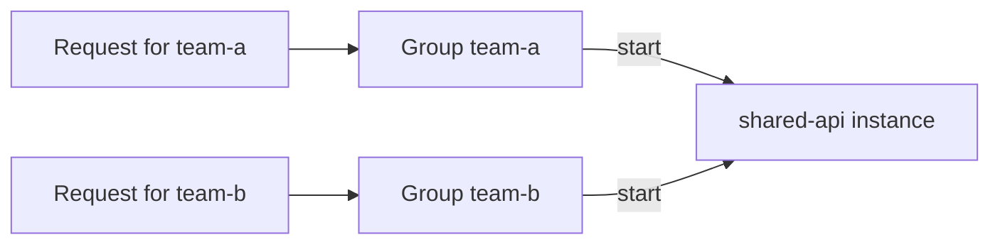



Put an instance in several groups at once by listing them in its `group` setting. A session for **any** of its groups starts it.

For example, a `shared-api` instance in the groups `team-a` and `team-b` starts for a `team-a` session and for a `team-b` session.

- **How you write the list depends on your provider.** Your provider page shows the syntax.
- **Spaces around group names are ignored**, and duplicate names are removed.
- **An instance without the setting is in the `default` group.**
- **An instance that loses all its groups**, for example when the setting is removed at runtime, leaves every group it belonged to.
