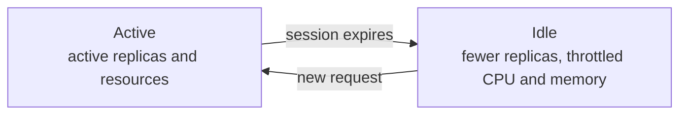



Scale a workload down instead of stopping it. When the session expires, Sablier **lowers the replica count** instead of stopping the workload, and **restores it** when a new session is requested.

With an idle replica count of `1` or more, the workload **keeps running** and its resources can be **throttled** while idle (CPU, memory or block I/O, depending on the provider). This removes cold starts, at the cost of keeping the workload alive.

## Idle and active profiles

Every scale-mode setting comes in an `idle` and an `active` variant:

- **`idle.*` is applied when the session expires.**
- **`active.*` is restored when a new session is requested.**

| Setting | Format | Default |
|---------|--------|---------|
| `idle.replicas` | Integer | `0` (stop) |
| `active.replicas` | Integer | `1` |
| `idle.cpu` / `active.cpu` | See [Scale CPU](/features/cpu-limits/) | none |
| `idle.memory` / `active.memory` | See [Scale memory](/features/memory-limits/) | none |
| `idle.blkio-*` / `active.blkio-*` | See [Scale block I/O](/features/disk-io-limits/) | none |

- **`idle.replicas` at `0`**, the default, stops the workload on session expiry and starts it again on demand.
- **`idle.replicas` at `1` or more** keeps the workload running, with optional throttling.
- **Set the `active` value of every limit you set on `idle`.** Depending on the provider, an idle limit is not always cleared on wake-up.

Your provider page lists the profiles it supports, the value formats, and how a change is applied.

## Per-resource guides


  
  
  

