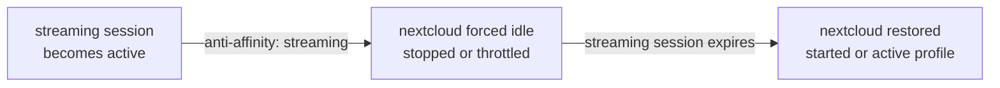



Make an instance back off automatically while another group is in use, with the `anti-affinity` setting. It lists the groups the instance yields to.

Use it when heavy services compete for a resource that cannot be shared, most often GPU memory or RAM, and running them together causes an out-of-memory crash or a severe slowdown. For example, a Nextcloud instance with `anti-affinity` set to `streaming` frees the GPU whenever the `streaming` group, Plex, has an active session.

How it works:

- **When a session for a listed group becomes active**, Sablier forces the instance to its idle state:
  - a plain instance is **stopped** (paused with the Docker pause strategy);
  - an instance in [scale mode](/how-to-guides/scaling-resources/scale-mode/) gets its **idle resource profile** instead.
- **When that session expires** and no other listed group is active, Sablier **restores** the instances it forced idle: it starts them again, or applies their active profile.
- **You can list several groups.** The instance stays idle while **any** of them is active.

Behavior notes:

- **Only instances Sablier actually forced idle while they were running are restored.** An instance that was already idle is left untouched.
- **The relationship is one-directional:** the instance yields to the group, not the reverse.
- **A request for a held instance does not start it.** While a listed group is active, the instance is reported as `not-ready` with the message *"paused while group \"streaming\" is active (anti-affinity)"*, shown on the waiting page (with `show_details`) and in the API response. A **blocking** request keeps waiting and times out if the other group outlasts its timeout. The **dynamic** waiting page keeps refreshing and starts the instance once the other group's session expires.
- **The instance must be managed by Sablier** (its `enable` setting is `true`), so Sablier can stop and start it.
- **Sablier reconciles on session start and expiry**, with a periodic safety net.
