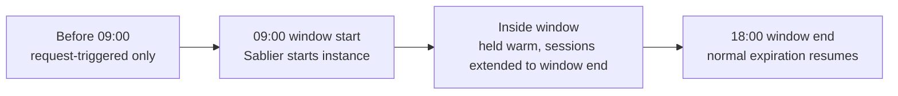



Keep an instance running during set hours of the day, whatever the traffic, with the `running-hours` setting. Add `running-days` to limit those hours to some weekdays.

- **At the start of the window**, Sablier starts the instance.
- **During the window**, sessions started by requests are extended to the window end, so the instance is not stopped mid-window.
- **After the window**, normal session expiration resumes.

## Format

- **`running-hours`** is a daily window in 24-hour `HH:MM-HH:MM`, for example `09:00-18:00`. When the start is later than the end, the window spans midnight, like `22:00-06:00`. An invalid value is ignored.
- **`running-days`** lists weekdays by full name (`Monday`) or abbreviation (`Mon`), case-insensitive. Without it, the window applies every day; an invalid value is ignored. Your provider page shows the list syntax.
- **An overnight window belongs to the day it starts:** with `Fri` and `22:00-06:00`, it runs from Friday 22:00 to Saturday 06:00.

## Time zone

Running hours use the time zone of the Sablier process. The official image includes the time zone database and defaults to `TZ=UTC`. Set the `TZ` environment variable, for example to `Europe/Paris`, where Sablier runs; your provider page shows how.
