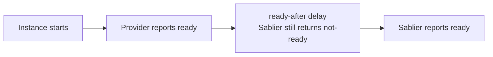



Delay when Sablier reports an instance as ready with the `ready-after` setting. Use it when a service passes its readiness check before it can serve traffic, such as a JVM application that opens its port before loading its caches, or a database that accepts connections before it accepts queries.

Once the provider reports the instance as ready, Sablier keeps answering *not ready* to blocking and dynamic requests until the delay has passed.

- **The value is a Go duration**, such as `500ms`, `30s`, `1m30s` or `2m`.
- **The delay counts from the first time the instance becomes ready in a session.** It does not restart on later requests.
- **An absent or invalid value means no delay.**
