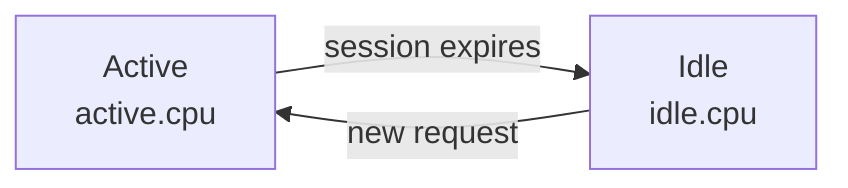



Throttle an instance's CPU when it is idle and restore it on wake-up, with the `idle.cpu` and `active.cpu` settings. The instance stays warm, so there is no cold start, but an idle workload no longer takes CPU that active workloads need.

| Setting | Applied when |
|---------|--------------|
| `idle.cpu` | the session expires |
| `active.cpu` | a session is requested |

- **Both need `idle.replicas` at `1` or more**, so the workload keeps running while idle. See [Scale instead of stop](/how-to-guides/scaling-resources/scale-mode/) for the shared idle and active model.
- **The value format depends on your provider**, for example decimal cores or a resource quantity. Your provider page shows it.
