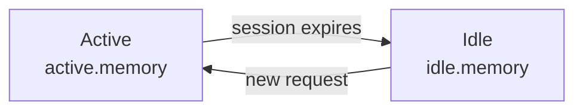



Cap an instance's memory when it is idle and restore it on wake-up, with the `idle.memory` and `active.memory` settings. The instance keeps running instead of stopping.

| Setting | Applied when |
|---------|--------------|
| `idle.memory` | the session expires |
| `active.memory` | a session is requested |

- **Both need `idle.replicas` at `1` or more.** See [Scale instead of stop](/how-to-guides/scaling-resources/scale-mode/) for the shared idle and active model.
- **The value format depends on your provider**, for example `64m` or `64Mi`. Your provider page shows it, along with side effects such as swap or restarts.
